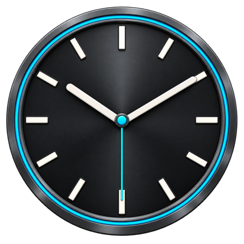

# OBS Clock User Guide

**Version 1.1.0**  |  OBS Studio 33  |  Windows macOS and Linux  |  November 1 2026

OBS Clock adds an analog clock source with selectable artwork, background images, and daily countdown messages. This guide covers installation on each OBS platform and the version 1.1.0 controls.

## Choose the correct installer

Download the OBS Clock installer matching your operating system and OBS architecture. Each installer places the plugin and its resources in the appropriate location. A Windows DLL cannot run on macOS or Linux.

| OBS platform | Select this installer | Plugin format |
| --- | --- | --- |
| Windows x64 | Windows x64 installer | .dll |
| Windows portable x64 | Windows installer with portable destination | .dll |
| macOS Apple silicon | Apple silicon or universal macOS installer | .plugin bundle |
| macOS Intel | Intel or universal macOS installer | .plugin bundle |
| Linux native | Package for your distribution and architecture | .so library |
| Linux Flatpak | OBS Flatpak plugin extension | Flatpak extension |

The installer must support your OBS version. Use the platform instructions on the following pages, then configure the clock using the common controls described later in this guide.

### Before installing

Close OBS completely. Use only the matching platform package and retain its supplied folder structure and support files. Keep a copy of the previous plugin until the replacement has been checked.

**Existing scenes:** The internal native source identifier is preserved in the current Windows build. An old Lua Clock source is a separate source type; add OBS Clock to replace it. Moving scenes between systems may also require relinking background image files.

The following pages provide platform installation instructions, appearance controls, time zones, scheduled messages, external text sources, and troubleshooting.

<!-- page -->

## Install on Windows

### Standard installation

1. Close OBS completely.
2. Run the **OBS Clock Windows x64 installer**.
3. Select the standard OBS installation and complete setup. Approve a Windows permission prompt if required.
4. Restart OBS, then follow Start the clock below.

The standard OBS 33 plugin location is:

`C:\ProgramData\obs-studio\plugins\OBS-Clock\OBS-Clock.dll`

### Windows portable installation

1. Close the portable OBS instance.
2. Run the Windows installer and choose its **portable installation** option or destination.
3. Select the portable OBS root folder, which contains bin. Do not select bin/64bit itself.
4. Complete setup, launch that OBS instance in portable mode, and add the clock.

For a portable OBS root of D:\OBS, the plugin belongs here:

`D:\OBS\plugins\OBS-Clock\OBS-Clock.dll`

Portable launches ignore plugins in ProgramData. Each separate portable installation needs its own plugin installation.

### Manual installation fallback

If using a ZIP package, preserve its supplied layout. For the current Windows DLL-only package, create the appropriate OBS-Clock folder above, copy in the DLL, and name it **OBS-Clock.dll**. Its artwork is bundled inside the DLL. The folder and DLL names must match.

Remove earlier copies of this clock plugin, including simple-clock.dll or OBSClock.dll, from other OBS plugin locations. Leave unrelated plugins in place. Do not put third-party plugins in core or use the older bin/64bit nesting under ProgramData.

### Start the clock

1. Start OBS. In a scene, select **Sources > + > OBS Clock** and create a new source.
2. Start with **Broadcast** for Face, **Broadcast** for Hands, and **Smooth sweep** for second-hand movement.
3. Resize and position the clock using the source transform handles in OBS.

<!-- page -->

## Install on macOS and Linux

### macOS Apple silicon and Intel

1. Quit OBS completely.
2. Open the **OBS Clock macOS installer** matching your OBS architecture: Apple silicon ARM64, Intel x86_64, or universal.
3. Complete the installer and follow any macOS permission prompts.
4. Restart OBS. Select **Sources > + > OBS Clock** and create a source.

**Manual installation fallback:** If the release supplies a bundle instead, in Finder choose Go > Go to Folder and enter:

`~/Library/Application Support/obs-studio/plugins/`

Create the plugins folder if needed and copy the complete **OBS-Clock.plugin** bundle into it. The tilde means your home folder. Keep the bundle intact; do not copy or rename the Windows DLL.

### Linux native installation

1. Close OBS completely.
2. Install the **OBS Clock package** for your distribution, OBS version, and architecture using the distribution's package installer.
3. Complete any dependency installation requested by the package manager.
4. Restart OBS and add **OBS Clock** through Sources.

**Manual installation fallback:** Follow the supplied archive's instructions and preserve its library and data layout. OBS lists this user plugin directory:

`~/.config/obs-studio/plugins/`

The plugin uses a **.so** shared library. System package locations vary by distribution; use the package's paths rather than copying the Windows DLL. The release package instructions govern the exact internal layout.

### Linux Flatpak installation

1. Close OBS completely.
2. Install the **OBS Clock extension for OBS Studio Flatpak**, using the software manager or the release's Flatpak installation command.
3. Select the extension matching the OBS Flatpak runtime and architecture.
4. Restart Flatpak OBS and add **OBS Clock** through Sources.

A native Linux package does not install the Flatpak extension. Use the package intended for the way OBS itself was installed.

<!-- page -->

## Choose the clock appearance

**Face** and **Hands** are separate choices. Select both when trying a coordinated style, or mix them to create another look. The following pairings are useful starting points.

| Face | Suggested hands | Character |
| --- | --- | --- |
| Broadcast | Broadcast | Clean markings and tapered hands |
| Railway | Railway | Heavy rectangular marks and a round second-hand tip |
| Classic ivory | Classic ornate black or brass | Roman numerals and an ivory dial |
| Studio Dark | Studio white and orange | Charcoal dial with bright hands |
| Church Tower | Gothic brass | Decorative rim and traditional numerals |
| Neon | Neon | Cyan and purple accents with adjustable glow |
| Minimal transparent | Minimal | Sparse markings for an overlay |

The original face choices and hand sets are also available. On some older raster styles, separately controlled markings may look slightly different from the original flattened artwork.

### Control the markings and motion

**Show tick marks** and **Show numbers** are independent. Check either, both, or neither. **Show second hand** separately controls whether the second hand is visible.

Choose **One-second tick**, **Quarter-second tick**, or **Smooth sweep** for second-hand movement. These choices do not change the displayed time.

**Opacity** controls the entire clock source: 100% is fully visible and 0% is invisible. The checkboxes follow the Opacity slider in the properties window.

### Use the Neon controls

Choose Neon as the face or hand style to reveal **Neon glow**. Select **Neon transparent face** to remove the dark dial background. A separate background image can still be used behind the clock.

**Tip:** Leave Override artwork colors off when you want the designed colors of a selected face and hand set.

<!-- page -->

## Add an image and change colors

### Use a background image

1. At the bottom of the properties window, check **Use background image**.
2. Select an image in the file picker that appears. PNG, JPEG, and BMP files are supported. Square artwork is recommended; it is scaled to the clock's 500 by 500 pixel dial area.
3. If the image already contains a clock dial, turn **Show tick marks** and **Show numbers** off. Otherwise, keep the markings you want OBS Clock to supply.
4. Choose hands that remain readable over the image. A PNG can include transparent areas.

The background replaces the built-in plate while selected markings and hands remain separate layers. Unchecking Use background image restores the built-in plate and retains your chosen image path for later use.

### Override artwork colors

Check **Override artwork colors** to reveal the color controls. Uncheck it to return to the artwork and default text colors; saved color choices are retained.

| Color control | What it changes |
| --- | --- |
| Face and background tint | Tints the plate or image while preserving its details |
| Numbers color | Changes the clock numerals |
| Tick marks color | Changes the hour and minute marks |
| Hour hand color | Changes the hour-hand silhouette |
| Minute hand color | Changes the minute-hand silhouette |
| Second hand color | Changes the second-hand silhouette |
| Digital time and date color | Changes the labels drawn by the clock |
| Countdown color | Changes the message drawn under the clock |

Use Opacity for transparency rather than looking for an alpha control in a color picker. In external text-source mode, format the message in that text source; the clock's Countdown color is hidden.

<!-- page -->

## Set digital time and time zones

### Add time and date labels

Check **Show digital time below dial** or **Show date below dial** to add either label. Digital time supports 12-hour or 24-hour display and optional seconds. The date can use a descriptive format or YYYY-MM-DD.

Text is white by default. To change it, check Override artwork colors and use **Digital time and date color**. This can improve contrast over a light scene.

Adding labels increases the source height. You may need to adjust the source transform after enabling them. Each inline text row adds 44 pixels below the 500 by 500 pixel dial. Labels are separate from the face artwork.

### Select a time zone

The default is **System local time**. Choose **UTC** or another available time zone when offered by your platform build. Time-zone names can differ by operating system. The hands, digital labels, date, and scheduled message all use that source's selected zone.

The operating system applies its daylight-saving rules. On Windows, a label such as Mountain Standard Time identifies the zone even while it is observing daylight time. UTC has no daylight-saving adjustment.

OBS Clock uses the computer's system clock as its time reference. It does not add a separate time-synchronization service.

### Create independent clocks

Create a new OBS Clock source for each independently configured clock. For example, use one source for local time and another for UTC.

Adding an existing source to another scene creates another reference to that same clock and its settings. Choose a new source when you want a different face, message schedule, or time zone.

**Daylight-saving note:** The message schedule follows the displayed wall-clock time. If a time repeats during the autumn clock change, its countdown interval can repeat as well.

<!-- page -->

## Show a scheduled message

There are two levels of message controls. **Show message** enables the feature. The optional **Send to OBS text source instead of clock** checkbox chooses where the message appears.

### Display the message below the clock

1. Check **Show message** below the Opacity slider.
2. Enter **End time** using a 24-hour time such as 10:00 or 9:30.
3. Enter **Message**, for example Service starts in.
4. Leave **Send to OBS text source instead of clock** unchecked.

OBS Clock appends the remaining time to your message. It uses MM:SS, beginning at 60:00. For example: **Service starts in 05:00**.

The message appears one hour before the selected End time, disappears at End time, and repeats the next day. It follows the source's selected time zone. Unchecking Show message disables both the message and countdown.

### Daily message example

With End time set to **10:00**, the schedule is:

| Time in the selected zone | Result |
| --- | --- |
| Before 09:00 | Message is hidden |
| 09:00 | Service starts in 60:00 |
| 09:55 | Service starts in 05:00 |
| 10:00 | Message is hidden |
| 09:00 the next day | The daily countdown starts again |

An invalid End time is marked in the properties window and produces no countdown. The analog clock continues to run. A blank Message displays just MM:SS.

The inline message row keeps its space while enabled, even outside the display interval. This prevents the clock source from resizing when the message appears or clears. Longer messages are reduced to fit; very long text may be shortened on screen. Use an external text source for more control over formatting.

<!-- page -->

## Send the message to a text source

Use this option when you want OBS to control the message's font, size, color, placement, and filters independently of the clock.

1. Create a dedicated **Text (GDI+)** or **Text (FreeType 2)** source in OBS. The exact source label depends on the OBS installation. Keep **Read from file** off.
2. Add that text source to the scene where you want the message to appear. Set its font, size, colors, alignment, position, and filters in OBS.
3. Open the OBS Clock source properties and check **Show message**.
4. Set End time and Message.
5. Check **Send to OBS text source instead of clock**. Select the dedicated source from the **Countdown text source** dropdown.
6. If you created the text source after opening the clock properties, close and reopen the properties to refresh the list.
7. Check the result during the final hour before End time. The selected source receives the complete message plus MM:SS.

Checking this option removes the message row from the clock. Only the text content of the selected source is updated. Its font, colors, transforms, filters, and visibility remain under your control in OBS.

The selected text source is cleared outside the one-hour interval, including at End time. Use a dedicated source so the countdown does not replace other text. Do not assign two clocks to the same text source.

Renaming a selected text source preserves its connection. If you delete and recreate it, select the replacement in the dropdown. A missing source is identified as unavailable.

The clock continues updating the selected text source even when the clock itself is not visible. Keep the clock source in the scene collection. Switching destinations, disabling the feature, or removing the clock clears its last published text when that text still belongs to the clock.

**Quick test:** Set End time a few minutes ahead in the selected zone, verify the displayed MM:SS, then check that the text clears at End time. Restore the intended schedule afterward.

<!-- page -->

## Troubleshoot and maintain

| Symptom | What to check |
| --- | --- |
| OBS Clock is absent from Sources | Confirm the correct platform build and architecture, its installation path, and a complete OBS restart. Use the installer matching the way OBS was installed. Check Help > Log Files > View Current Log. |
| Duplicate or unexpected clock entries | Remove earlier copies of this clock DLL from other plugin locations. An old Lua Clock source is a separate source type. |
| Numbers or marks are missing | Check Show numbers and Show tick marks. Your background may already contain its own markings. |
| Color controls are missing | Check Override artwork colors. Countdown color is not used in external text-source mode. |
| A scheduled message is missing | Check Show message, valid End time, the selected time zone, and whether the current time is within the final hour. |
| An external text source stays blank | Confirm its dropdown selection, Read from file off, scene visibility, and the one-hour schedule. Reopen properties after creating a new text source. |
| Digital labels have poor contrast | Enable Override artwork colors and choose a suitable Digital time and date color. |

### Update the plugin

Close OBS completely. On Windows, replace OBS-Clock.dll in its existing OBS-Clock folder, using the portable folder when applicable. Normally, run the updated installer or update the package through your software manager. For manual macOS installation, replace the complete .plugin bundle; for native Linux, follow its package instructions; for Flatpak, update its extension. Restart OBS and check the clock. Retain the prior package until testing is complete.

### Export this guide as PDF

Open this document in Word, choose Save As or Export, and select PDF. Use standard print quality and confirm that all pages are included. Inspect the exported PDF for clean tables, page breaks, and readable images before including it with a release.

The project contains the editable Word guide, its Markdown source, and a script for rebuilding the Word version. Keep the guide version aligned with the DLL version when preparing later releases.

### Installation references

OBS plugin guide: https://obsproject.com/kb/plugins-guide

OBS 33 Windows layout: https://obsproject.com/kb/legacy-plugin-developer-info

